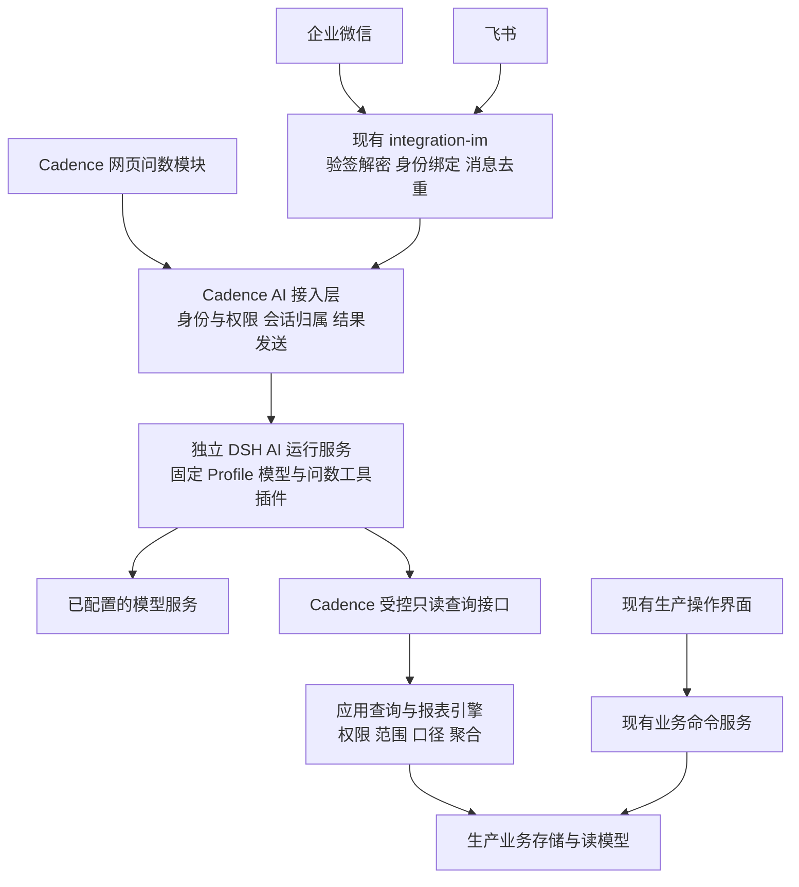

# Cadence 内置 AI 问数与 DSH 集成架构草案

日期：2026-10-28（Asia/Shanghai）｜产品与架构负责人：[Cadence PM](thread://01a17d85-16ec-7c42-a86d-7d42711031a3?hostId=local)

**产品方向已由 Owner 明确：Cadence 自带 AI 问数功能模块，参考 OwlCodaE 的 DSH 架构，考虑以 DSH 插件体系作为 AI 底座，接入企业微信与飞书，并与生产系统划清职责。** 本文提出具体拓扑、能力合同和交付顺序；DSH 选用版本、实现细节及排期仍是方案阶段，未形成 accepted ADR 或实施派工。

建议采用 **Cadence 产品入口＋独立 DSH AI 运行服务＋受控业务查询服务**。网页、企业微信、飞书共用问数能力与权限规则；生产系统继续掌握业务事实、指标口径和业务命令。AI 模块作为 Cadence 的安装与交付组成部分，可按租户和模块授权启用。

## 1. 用户得到什么

用户在 Cadence 页面或企业 IM 中用自然语言提出问题，得到可核对的数字、简明解释及有权限的业务详情链接。问题有歧义时先澄清对象或时间范围；缺数据、无权限和暂不支持分别说明。

| 问数主题 | 代表性问法 | 结果应包含的事实 |
| --- | --- | --- |
| 工作令与生产进度 | 这张工作令目前做到哪一步，还有哪些任务没完成？ | 对象、当前状态、完成口径、未完成任务和来源记录 |
| 物料与库存 | 这张工作令还缺哪些材料，哪些已有采购安排？ | 需求、可用库存、占用与缺口口径，关联采购单及各自状态 |
| 质量 | 本周哪些检验未通过，后续处置是什么？ | 时间范围、检验判定、处置状态；事实与原因推测分开 |
| 采购与外协 | 哪些交货已逾期，影响哪些工作令？ | 约定交期、实际交付、关联关系；没有排程证据时不宣称已算出最终延期 |
| 工时与经营统计 | 本周各车间有效工时是多少？ | 已接通且已核对的统计口径、单位、数据范围和更新时间 |

首个闭环建议选前三类，随后按真实可用读面扩展。知识文档检索可辅助解释术语、流程和使用方法；库存、进度、数量等动态事实取自业务查询，不能用文档检索或历史聊天代替。

## 2. 从 OwlCodaE 继承的架构原则

[OwlCodaE ADR-0018](/Users/yeemio/AI/gitrep/OwlcodaE/architecture/decisions/0018-dsh-hosted-product-shell-v0.1.md)明确将 DSH Web/Client 作为该产品主交互壳，通过公开 Profile、Bundle、Host 与 client 插件组合；业务核心、业务存储与业务决定保持独立。其本地 [integration-dsh 包](/Users/yeemio/AI/gitrep/OwlcodaE/packages/integration-dsh/package.json)和 [Profile](/Users/yeemio/AI/gitrep/OwlcodaE/packages/integration-dsh/product-composition/profile/package.json)也体现了边缘隔离与精确版本绑定。

Cadence 继承以下保证：

1. DSH 承担模型调用、会话、工具编排和执行记录；Cadence 决定查询权限、业务含义及可对用户展示的结果。
2. DSH/Cordis 类型只进入集成边缘与运行服务组合根，不进入业务核心、应用查询合同或领域 UI。
3. 使用公开扩展入口，固定一组经过验证的包、Profile 和插件版本；产品启动可读回实际组成。插件按发布版本交付，普通业务用户不能临时装插件或修改运行配置。
4. 会话结束、工具成功和生成回答只表示 AI 执行状态，不创建生产事实，也不构成业务审批。

**Cadence 的建议主界面仍是现有 MES 工作台。** AI 问数是其中的正式模块；DSH 提供独立 AI 运行服务，通过公开接口连接。可复用的 DSH 会话组件须在选定版本下验证后决定，不预设其已支持任意嵌入方式。OwlCodaE 的主壳选择不能直接变成 Cadence 已接受的产品改造。

沿用 [ADR-0003](decisions/ADR-0003-架构向OwlCodaE靠拢.md)的模式参考与零代码复制约束；本方案不搬运 OwlCodaE 或 sieracMes-AI 源码，也不照搬 OwlCodaE 的完整 WorkCase／ResultAdmission 业务链。

## 3. 产品与运行拓扑

从用户角度是一套 Cadence。私有化安装可在同一部署包中包含业务服务和 AI 服务，但使用不同进程、运行身份、资源限额和数据目录。AI 服务失效时，报工、质检、库存等生产操作继续工作；问数入口明确显示暂不可用。

AI 服务不持有生产数据库账号，不直接执行 SQL，不挂载生产业务数据目录。查询走内部受控接口；数据库只读查询、索引或后续读副本仍由 Cadence 存储层负责。初版按实际负载选择现有读面，不预先建设数仓。

私有化可按客户部署一份 AI 运行服务。SaaS 初期建议以租户隔离的运行实例、会话目录与凭据建立基线；共享运行进程须先证明上下文、插件状态、缓存和日志的租户隔离。仅在 Session 中加入 tenantId 不能证明隔离成立。

## 4. 插件与代码责任

以下是建议的责任位置，不表示这些新目录已经创建。

| 位置 | 责任 |
| --- | --- |
| `packages/application` 内的问数查询模块 | 定义业务能力、输入范围、授权要求、对象解析、结果合同；不依赖 DSH |
| `packages/engine-reporting` 与 `packages/business-store` | 复用版本化指标与确定性计算，实现获准范围的读取、聚合和来源定位 |
| `packages/integration-dsh` | Cadence 的 DSH Profile／Bundle、问数工具适配、模型与执行记录适配；厂商类型止于此 |
| 现有 `packages/integration-im` | 企微／飞书协议、验签解密、消息映射、身份映射端口与发送；向统一接入层交付可信渠道事件 |
| `apps/server` | 组合 AI 接入接口和受控查询接口，完成身份绑定、模块授权、查询鉴权与发送前检查 |
| 建议的 `apps/ai` | 组合并启动独立 DSH 服务，注入受限查询客户端、模型配置、运行存储与限额 |
| `apps/web` 与 `packages/product-ui` | 既有导航中的问数页、提问上下文、结果卡片及详情跳转；领域 ViewModel 不含 DSH 类型 |

DSH 插件中保留三个清晰职责：模型插件调用已配置模型；问数工具插件把受控业务能力暴露给 Agent；渠道桥接插件将统一消息与会话连接起来。企微和飞书的协议实现继续归 `integration-im`，不在 DSH 内再维护一套身份、权限或业务查询。

**插件机制提供扩展能力，不自动构成权限隔离。** 面向客户的问数 Profile 只装配所需能力，不开放通用终端、任意文件、自由网络访问、动态插件安装或生产写工具。运行身份和网络策略必须使未授权能力实际不可达，不能只靠提示词约束。

依赖方向遵守 [ADR-0011](decisions/ADR-0011-引擎与边缘包依赖方向补则.md)：应用／存储可依赖水平引擎，apps 组合边缘适配，应用与领域 UI 不反向依赖集成包。

## 5. 一次问数的业务合同

1. **建立可信身份。** 网页从登录会话获取用户、租户与模块授权；IM 从已验证的企业／应用配置和平台用户映射取得 Cadence 身份。模型参数、聊天文本、显示姓名及调用方自填 tenantId 均不能赋予权限。
2. **理解与澄清。** AI 选择已注册能力并提出受约束的参数。工作令重名、时间范围不明或口径存在多个有效版本时，返回可选项让用户确认。
3. **服务端授权与执行。** Cadence 在每次查询重新验证身份、能力、对象范围和可返回字段，限定时间窗、行数、分页及查询耗时；租户约束继续贯穿存储读取。AI 只能缩小授权范围。
4. **确定性计算。** 数量、金额、工时及分组汇总由业务查询／报表引擎计算，AI 根据结构化结果解释。分页未取全不能总结成完整总量；跨域组合须保留各数据集的时间与完整性。
5. **组织与交付回答。** 结果卡片中的数字和来源由结构化结果呈现；AI 生成说明并区分事实与推测。发送前再次检查目的地及访问权限，详情链接点击后继续鉴权。

建议问数能力至少定义以下合同字段，后续实施在同一合同中确定 wire 形状：

| 合同部分 | 必备内容 |
| --- | --- |
| 能力定义 | capabilityId、版本、业务说明、输入 schema、所需权限、允许对象／字段、最大查询范围 |
| 执行上下文 | 服务端绑定的 tenant／user／scope、渠道与会话归属、requestId；不可由模型替换 |
| 数据结果 | 行列、单位、有效过滤条件、统计口径及版本、时间基准与时区、来源记录引用 |
| 完整性与时效 | 查询时刻、各数据源更新时间或未知、完整／截断、已取行数、总量可知性、分页情况 |
| 结果状态 | 成功有数据、成功无记录、无权限、不支持、数据源未就绪、超时／失败；零值由有效查询产生 |
| 审计关联 | 用户请求、工具调用、结果引用、模型／插件版本、发送结果、用量与耗时；未知用量如实标记 |

当前 [D-18](ROADMAP.md#pm-current-tasks)仍有上游读面未接、数值未验的边界。相关问法必须显示数据未就绪，不能因空集合计算结果为零就称作实际经营事实。报表口径需要先绑定有效数据源与可用状态。

图纸保密许可当前仍有 [P2-3／O5](contracts/drawing-module/CONTRACT.md) 的身份绑定待定。首版不向 AI 暴露依赖自声明 clearance 的受限图纸内容。薪酬、个人工时及敏感成本等查询应分别定义授权与字段策略，不能凭拥有 AI 模块权限一并开放。

## 6. 企业微信与飞书如何接入

复用现有 [integration-im](../packages/integration-im/README.md) 的统一消息和身份绑定端口，并在真实接入阶段补齐尚未完成的回调验签、解密与票据能力。接口和适配器存在，不代表企业应用已经开通或真实双向消息已验收。

两种渠道使用同一问数能力集与结果合同。会话按租户、用户、渠道、会话目标划分；不同渠道之间不自动拼接私密历史。权限撤销后，后续工具调用、历史引用和回答交付均须执行新的权限检查。

首版建议以个人会话提问和回复为默认。群里收到提问不等于全群成员均有权看到提问者可见的数据；群消息只给获准的公共摘要或引导进入个人会话，群内业务数据披露需要单独的目的地规则。

渠道事件按企业／应用及平台消息标识去重，记录处理与发送结果。重试复用同一处理记录，避免重复消耗模型及重复回复；对无法确认的发送结果保留未知状态，不冒称严格的跨系统一次送达。链接打开仍需 Cadence 身份校验。

模型密钥和企业应用凭据保存在服务端凭据配置中，不进入提示词、页面、聊天或普通日志。外发给模型的数据须在查询授权之后再按模型使用策略裁剪；客户数据能否离开部署环境是独立配置与授权条件。

## 7. 生产运行与 AI 的边界

业务数据库保存生产事实；DSH 会话存储保存交互和执行记录。AI 历史不是库存、状态、工时或财务账本。问数审计记录必要的查询范围、证据引用与发送结果，敏感载荷按保留规则处理，不默认永久复制所有业务数据。

查询必须设置可取消的耗时与工作量上限；模型调用按租户设并发、调用次数和费用预算，失败不能无限重试。取消或超时后停止继续调工具，页面或 IM 给出可理解的状态。限额和 AI 进程重启不改变生产事务或队列。

部署包分别记录 Cadence 与 DSH 的版本、Profile、插件、配置引用和会话存储位置。DSH 升级可独立撤回，必要的会话存储迁移在升级方案中说明；本方案不要求生产数据库随每次 AI 升级迁移。

后续如加入报工、派工、审批或库存调整，AI 只能提出操作意图。实际执行仍须走现有业务命令、权限、对象版本、幂等及审批规则，并定义明确的人机确认。**首版合同限定只读问数，不装配生产写能力。**

## 8. 建议交付顺序与完成条件

| 顺序 | 形成的结果 | 可观察完成条件 |
| --- | --- | --- |
| 架构定稿 | 选定 DSH 公开接缝、版本与最小 Profile，确定首批能力及数据策略 | 一个合成只读能力从 Cadence 接入层通过真实 DSH 工具链返回结构化结果，证实可用接缝；据此形成 accepted ADR 和有界实施合同 |
| 网页问数闭环 | 工作令、物料缺口、质量三类查询及可追溯结果 | 在约定数据与口径下，与业务页面／查询结果对得上；歧义、无权限、未接数据源、截断与失败分别可见 |
| 企微与飞书 | 两个平台真实企业应用的身份、入站、问数与回传 | 已绑定用户在同一数据范围及时间基准下取得一致业务事实；跨租户、未绑定、撤权、重复回调和群披露边界有实际证明 |
| 交付与运营 | 两种部署形态的配置说明、审计、限额和恢复方案 | 准确版本可安装；AI 停止或超额时生产业务仍可用；模型及真实 IM 使用在获准环境内验收 |

以上是建议顺序，不是已经启动的实施波次。真实客户数据、模型提供方与费用上限、企业应用凭据、群使用范围在对应接入前具名绑定。先采用合成数据证明技术接缝，不因规划完成而自动调用付费模型或连接客户系统。

## 9. 与当前 PM 主线的关系

本方向作为一条目标记录进入 [ROADMAP](ROADMAP.md#pm-current-tasks)。**M2-R1 当前 REWORK 及其原责任链继续保留；本轮没有把 AI 开发追加进既有 M2 执行包。** PM 维护产品定义与架构提案，现有工程总控仍负责已授权的候选和工程账本。

下一次范围决定是：确定本方案的架构选择与首批问数合同，并给出 AI 实施的排期归属。产品方案确认后，再由唯一工程执行链承接；不新建等价控制器或重建 RunKit 账本。

## 10. 参考与已知基础

- [Cadence ADR-0003](decisions/ADR-0003-架构向OwlCodaE靠拢.md)、[ADR-0011](decisions/ADR-0011-引擎与边缘包依赖方向补则.md)：架构对齐及依赖责任。
- [Cadence integration-im](../packages/integration-im/README.md)：已有统一消息、渠道、身份端口及真实接入留白。
- [Cadence engine-reporting](../packages/engine-reporting/README.md)：版本化口径与确定性计算；具体数据源可用性仍按当前业务证据核定。
- [OwlCodaE ADR-0018](/Users/yeemio/AI/gitrep/OwlcodaE/architecture/decisions/0018-dsh-hosted-product-shell-v0.1.md)、[DSH 组合 Profile](/Users/yeemio/AI/gitrep/OwlcodaE/packages/integration-dsh/product-composition/profile/package.json)：模式参考。本次读取的 OwlCodaE 本地 HEAD 为 `73cff57ded8e3da80120a788c370e6b0d6eb2521`，工作区包声明为 `0.2.1-rc.2.owlcoda.1`；这是参考仓声明，不是 Cadence 版本选择或当前安装证明。
- [DSH 官方仓库](https://github.com/deepseek-ai/deepseek-harness)：2026-10-28 读取的 README 确认插件化架构，并提示开发预览阶段可能出现兼容性变化。因此消费端采用精确版本与公开接缝，不浮动跟随上游。
